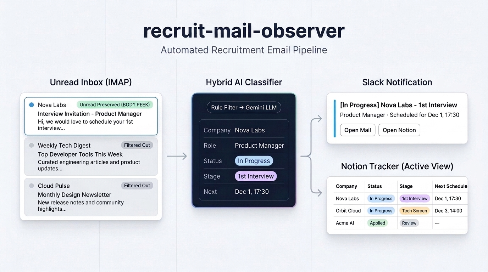

# recruit-mail-observer

Computer Use 없이 **표준 IMAP(Kakao · Gmail · Naver · Custom)**으로 읽지 않은 채용 프로세스 메일만 선별해 **Slack 알림**과 **Notion 이직 DB 상태 동기화**를 자동 수행하는 오픈소스 프로젝트입니다.



## 주요 특징

- **읽지 않음 상태 보존 (`BODY.PEEK[]`) + TLS 검증**: 서버 인증서와 호스트명을 검증(`ssl.create_default_context()`)하며, 스크립트가 메일을 읽어도 미열람 상태가 유지됩니다.
- **전 직군·멀티 메일 지원**: 개발, PM, 디자인, 마케팅 등 직군에 관계없이 Notion DB의 `직무` 옵션을 런타임에 자동 로드해 분류하며, `kakao` / `gmail` / `naver` / `custom` IMAP 프리셋을 지원합니다.
- **안전 기본값 + 2단계 하이브리드 분류**:
  1. **1차 룰 필터(무료·로컬)**: 기본값은 `LLM_PROVIDER=none`(외부 LLM 호출 없음)이며, 광고·맞춤 공고 추천 메일을 로컬에서 차단합니다.
  2. **2차 LLM 분류(명시적 활성화)**: `LLM_PROVIDER=gemini`(`gemini-4-hydrogen`, `thinkingLevel: "low"`) 또는 `LLM_PROVIDER=openai`(OpenAI API)를 명시적으로 켜면 회사명, 직무, `상태`, `최종전형`, `다음 일정`, 요약을 추출합니다. 신뢰도가 낮거나 폴백 분류인 경우(`needs_review`) Notion 자동 쓰기를 보류하고 Slack에 수동 확인 경고를 보냅니다.
- **2컬럼 Notion DB 동기화**: `상태`(진행중 · 합격 · 불합격 · 종료 · 메모)와 `최종전형`(커피챗 · 서류 · 스크리닝 · 과제/테스트 · 1차면접 · 2차면접 · 처우협의)을 분리해 관리합니다.
- **부분 실패 재개 & 무의존성 런타임**: 메일별 Notion/Slack 완료 상태를 분리 기록해 재실행 시 중복 쓰기를 방지하며, Python 3.9+ 표준 라이브러리만으로 동작합니다.

---

## 1. Notion DB 요구 스키마

단일 데이터 소스(single-source) Notion 데이터베이스와 아래 `Select`/`Date`/`Title` 컬럼 구성을 지원합니다. 실행 시 필수 컬럼명과 타입을 사전 검증합니다.

| 컬럼명 | Notion 타입 | 용도 |
| :--- | :--- | :--- |
| `전형 시작일` | `Date` | 신규 행 생성 시 메일 수신일 자동 기록 |
| `업데이트` | `Date` | 메일 수신 시마다 최신 수신일로 갱신 |
| `다음 일정` *(선택)* | `Date` | 면접일·과제 마감일 추출 시 자동 기록 (DB에 컬럼이 있을 때만 기록) |
| `Name` | `Title` | 회사명 (정확 일치 또는 `company_aliases` 매칭) |
| `상태` | `Select` | `진행중`, `합격`, `불합격`, `종료`, `메모` |
| `최종전형` | `Select` | `커피챗`, `서류`, `스크리닝`, `과제/테스트`, `1차면접`, `2차면접`, `처우협의` |
| `직무` | `Select` | 본인 직무 옵션(런타임에 Notion DB에서 자동 로드) |

> **추천 뷰 구성**: 기본 `표` 뷰에 **`상태` is `진행중`** 필터를 걸고, 필터 없는 `전체 이력` 뷰를 추가하면 진행 중인 전형만 집중해서 관리할 수 있습니다.

---

## 2. 데이터 처리 및 프라이버시 안내

- **외부 LLM 전송 범위(`LLM_PROVIDER=gemini|openai` 활성화 시)**: 발신자, 제목, 수신 시각, 본문 앞 3,000자, Notion DB의 `직무` 옵션 목록이 설정된 LLM API로 전송됩니다. `--dry-run`은 Slack/Notion/상태 저장만 건너뛰며, `LLM_PROVIDER`가 켜져 있으면 분류기는 실행됩니다.
- **CI 로그 보호**: 기본 CLI 출력은 건수와 예외 타입만 출력합니다. 로컬 디버깅 시 제목·요약을 보려면 `--show-details`를 명시적으로 추가하세요.
- **`state` 브랜치**: 처리된 메일의 `Message-ID` SHA-256 해시, 처리 시각, 처리 상태(및 부분 실패 재개용 메타데이터)가 기록됩니다. **`state` 브랜치나 실행 로그가 있는 운영 저장소는 절대 Public으로 전환하지 마세요.**

---

## 3. 단계별 온보딩 (로컬 검증 → Private 배포)

### 1단계: 로컬 룰-온리 Dry-Run (외부 전송 0)

```sh
uv sync
cp .env.example .env
# .env에 MAIL_PROVIDER, MAIL_EMAIL, MAIL_APP_PASSWORD만 입력 (LLM_PROVIDER=none 유지)

uv run --locked recruit-mail-observer --dry-run --show-details --max-emails 10
```

커스텀 규칙/스키마를 쓰려면 `--config-dir ./my-config` 옵션을 전달합니다(미지정 시 패키지에 번들된 기본 설정 사용).

### 2단계: 테스트용 Notion DB · Slack · LLM 연동 검증

1. 테스트용 Notion DB와 Slack 채널에 Integration / Webhook을 연결하고 `.env`에 `NOTION_TOKEN`, `NOTION_DATABASE_ID`, `SLACK_WEBHOOK_URL`을 입력합니다.
2. 클라우드 LLM을 쓰려면 `LLM_PROVIDER=gemini`(`GEMINI_API_KEY`) 또는 `LLM_PROVIDER=openai`(`OPENAI_API_KEY`)를 설정합니다.
3. `uv run --locked recruit-mail-observer --show-details --max-emails 5`로 실제 연동을 확인합니다.

### 3단계: 새 **Private Repository**에 배포 (GitHub Actions)

> GitHub에서 Public 저장소를 Fork하면 Fork도 Public으로 유지됩니다. **반드시 새 Private 저장소를 만들어 푸시하세요.**

```sh
git clone https://github.com/TayPark/recruit-mail-observer.git
cd recruit-mail-observer
git remote set-url origin git@github.com:<YOUR_ID>/recruit-mail-observer-private.git
git push -u origin main
```

1. 새 Private 저장소의 `Settings > Secrets and variables > Actions > Secrets`에 등록:
   - `MAIL_EMAIL`, `MAIL_APP_PASSWORD` *(카카오 전용 하위 호환: `KAKAO_EMAIL`, `KAKAO_APP_PASSWORD`)*
   - `SLACK_WEBHOOK_URL`, `NOTION_TOKEN`, `NOTION_DATABASE_ID`
   - 선택(LLM 사용 시): `GEMINI_API_KEY` 또는 `OPENAI_API_KEY` (또는 공통 `LLM_API_KEY`)
2. `Variables` 설정:
   - `MAIL_PROVIDER`: `kakao` | `gmail` | `naver` | `custom` (`custom`은 `MAIL_IMAP_HOST` 필수)
   - `LLM_PROVIDER`: `none` | `gemini` | `openai`
   - 선택: `MAIL_IMAP_MAILBOX`, `LLM_MODEL`, `MATCH_BY_ROLE`
3. `Actions > Observe Recruit Mail > Run workflow`에서 `dry_run: true`로 검증 후, 20분 주기(`*/20 * * * *`) 자동 실행을 확인합니다. `state` 브랜치를 초기화하면 최근 `LOOKBACK_DAYS` 내 미열람 메일이 다시 처리될 수 있습니다.

---

## 4. 테스트 및 기여

```sh
uv run --locked pytest -q
```

- 보안 취약점 제보: [SECURITY.md](SECURITY.md)
- 기여 가이드: [CONTRIBUTING.md](CONTRIBUTING.md)
- 라이선스: MIT ([LICENSE](LICENSE))
